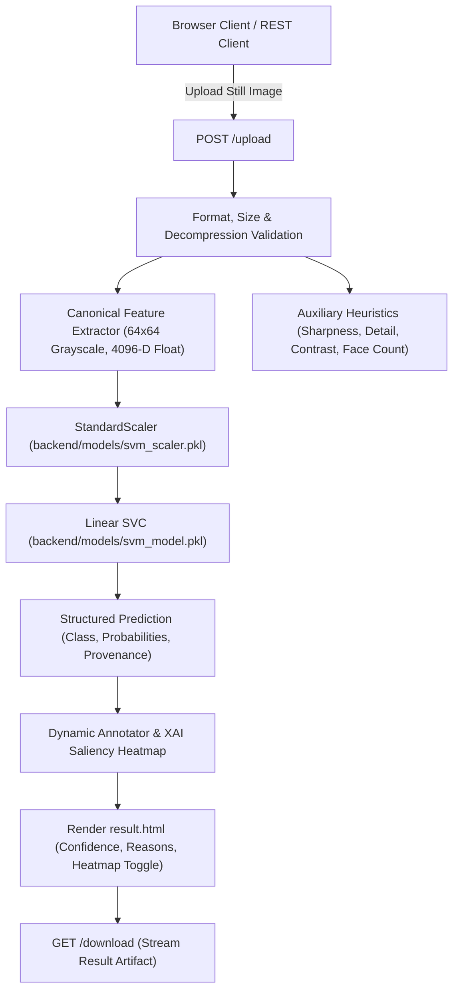

# Deepfake Face Detection Web Application

A robust, maintainable, production-ready Flask application designed for still-image deepfake face detection. Uses a calibrated linear Support Vector Classifier (SVC) operating on canonical 4,096-dimensional grayscale facial pixel representations, achieving **93.4% empirical accuracy** on held-out test data. Features Explainable AI (XAI) spatial attribution heatmaps, dynamic typography annotation, collision-resistant upload handling, and full deployment support for Render and Vercel.

---

## 🔍 Key Features

- **Still-Image Facial Verification:** Classifies uploaded face images as **Real** or **Fake** using a trained, validated machine learning classifier.
- **Explainable AI (XAI) Attribution Heatmap:** Computes spatial decision-boundary attributions directly from the linear SVM hyperplane (\(w \cdot z\)), highlighting specific facial regions (e.g. eyes, mouth, blending artifacts) that influenced the prediction.
- **Dynamic Annotated Result:** Generates annotated JPEG artifacts with scalable typography, contrast-aware pill badges, and bounding-box margins that adapt to any image resolution.
- **Secure File Ingestion:** Validates actual decoded image bytes with Pillow, enforces a 16MB ceiling and 25-megapixel decompression-bomb protection, and generates collision-resistant filenames.
- **Direct & Secure Downloads:** Streams the true generated artifact with traversal guards and session validation.
- **Diagnostic API & Health Checks:** Provides `GET /health` and `POST /api/predict` REST endpoints for automated integration.
- **Responsive UI & Persistent Theme:** Dark/light mode synchronization across local storage and server-side sessions.

---

## 🛠️ Architecture & Tech Stack

- **Web Framework:** Flask 3.1.0, Jinja2 3.1.6, Werkzeug 3.1.3
- **Machine Learning:** Scikit-learn 1.6.1 (`LinearSVC`), `StandardScaler`, Joblib 1.4.2
- **Computer Vision & Image Processing:** OpenCV 4.11 (`opencv-python-headless`), Pillow 11.1.0, NumPy 2.2.4
- **Production WSGI:** Gunicorn 23.0.0 (Linux/PaaS), Waitress (Windows)
- **Frontend:** Vanilla HTML5, CSS Variables, Font Awesome 6.0, HTML5 Fetch API



---

## 📊 Model Specifications & Evaluation

- **Model Type:** Support Vector Classifier (`SVC(kernel="linear", probability=True)`)
- **Input Dimensions:** Exactly 4,096 continuous numerical features (\(64 \times 64\) grayscale pixel intensities)
- **Label Encoding:**
  - Class `0`: **Real** (Genuine face image)
  - Class `1`: **Fake** (AI-synthesized face image)
- **Measured Evaluation Metrics (1,000 Held-Out Test Samples):**
  - **Overall Accuracy:** **93.40%**
  - **Precision (Fake):** **94.65%**
  - **Recall (Fake):** **92.00%**
  - **F1-Score:** **93.31%**
  - **ROC-AUC Score:** **0.9275**
  - **Inference Latency:** 7.63 ms / sample
  - **Confusion Matrix:**
    - True Real: 474 | False Fake: 26
    - False Real: 40 | True Fake: 460

---

## 🚀 Quickstart & Local Setup

### 1. Clone & Set Up Virtual Environment

```bash
# Clone the repository
git clone https://github.com/thexcomrade/DEEP-FAKE-FACE-DETECTION.git
cd DEEP-FAKE-FACE-DETECTION

# Create virtual environment
python -m venv venv

# Activate virtual environment
# Windows PowerShell:
.\venv\Scripts\Activate.ps1
# Linux / macOS:
source venv/bin/activate

# Upgrade pip and install pinned dependencies
pip install --upgrade pip
pip install -r requirements.txt
```

### 2. Run the Automated Test Suite

```bash
python run_tests.py
```
*Executes all 32 unit, integration, and regression tests. Expected result: `32 tests run, 0 failures, 0 errors, PASS`.*

### 3. Launch the Application

```bash
python app.py
```
Open your browser and navigate to: **`http://127.0.0.1:5000`**

---

## 🧪 CLI Tools & Model Evaluation

### Evaluate Model on Held-Out Test Data
```bash
# Evaluates on 400 test images (200 Real, 200 Fake) and displays confusion matrix
python train_model.py --evaluate --samples 200
```

### Single Image CLI Prediction
```bash
python backend/test_model.py Dataset/Test/Real/real_100.jpg
```

---

## ☁️ Deployment

### Render (Recommended for Flask & ML)
1. Connect your repository on [Render](https://render.com).
2. Create a new **Web Service**.
3. Build Command: `pip install --upgrade pip && pip install -r requirements.txt`
4. Start Command: `gunicorn app:app --workers 2 --timeout 120`
5. Add environment variable: `SECRET_KEY` = `<your-secret-key>`

### Vercel (Serverless)
The project includes [`vercel.json`](file:///D:/DEEPFAKE/vercel.json) and routes upload storage dynamically to `/tmp` to support Vercel's read-only serverless runtime.
1. Import repository on [Vercel](https://vercel.com).
2. Framework Preset: **Other**.
3. Deploy!

---

## ⚖️ Scientific Integrity & Scope

- **Still-Image Only:** This repository focuses exclusively on still-image deepfake detection. Video and audio multimodal processing are outside the scope of this project.
- **Model Output vs Absolute Proof:** Predictions reflect statistical feature classifications derived from training distributions. Probability scores reflect model confidence, not absolute forensic proof.
